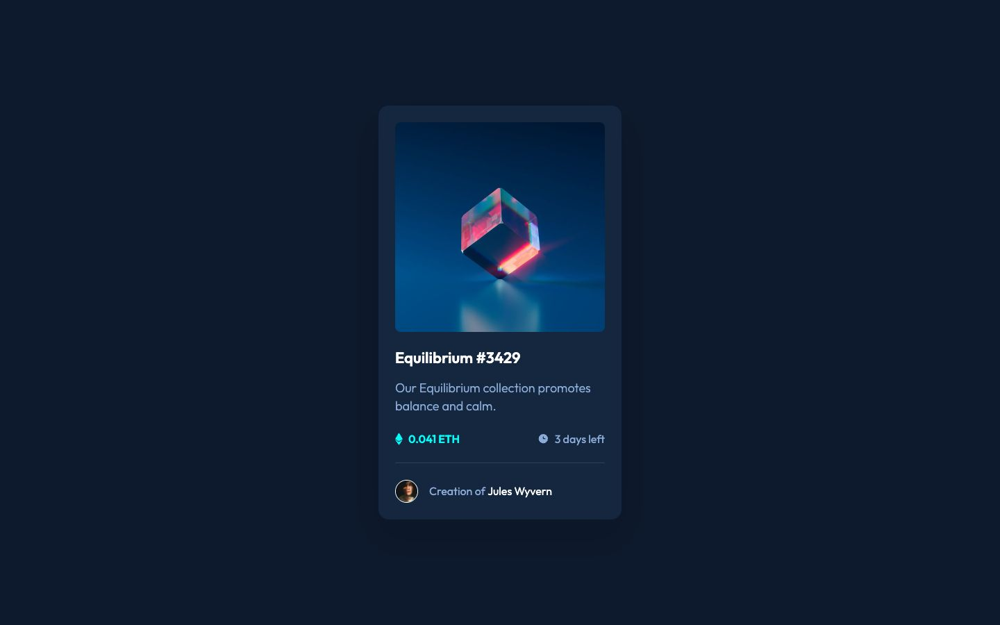

# Frontend Mentor - NFT preview card component solution

This is a solution to the [NFT preview card component challenge on Frontend Mentor](https://www.frontendmentor.io/challenges/nft-preview-card-component-SbdUL_w0U). The page shows the Equilibrium artwork, sample price, time remaining and creator credit in a responsive card.

## Table of contents

- [Overview](#overview)
- [The challenge](#the-challenge)
- [Screenshot](#screenshot)
- [Links](#links)
- [My process](#my-process)
- [Built with](#built-with)
- [What I learned](#what-i-learned)
- [Continued development](#continued-development)
- [Run it locally](#run-it-locally)
- [Author](#author)

## Overview

### The challenge

Users should be able to:

- View the optimal layout depending on their device's screen size.
- See hover states for interactive elements.

### Screenshot



### Links

- Solution URL: [My Frontend Mentor solution](https://www.frontendmentor.io/solutions/nft-preview-card-with-nextjs-typescript-and-tailwind-CRSex-fcUy)
- Live Site URL: [NFT preview card](https://nft-preview-card.royeradames.com)

## My process

### Built with

- Next.js 16.3.6 with the App Router and server components
- React 19.2.8 and TypeScript
- Tailwind CSS 4 and custom CSS
- CSS Grid, Flexbox and custom properties
- Native HTML links and `details` / `summary`
- Locally served Outfit font
- Playwright for browser tests
- ESLint

### What I learned

I took colours from the style guide and design references instead of matching them by eye. I kept the palette in CSS custom properties so the background, divider and text use the same values throughout the card.

I learned to keep the small avatar beside the first line when the creator text wraps at 320 px. I used `align-items: flex-start` on the creator row, prevented the avatar from shrinking and added a small top padding to the text.

I kept the cyan hover on the title and creator name because it is part of the design. I applied the same colour on keyboard focus. The artwork also shows the cyan overlay and eye icon on hover or focus.

I used ordinary links to open the original artwork and native `details` / `summary` to reveal the creator credit inline. These controls work without JavaScript. Keeping the credit inline avoids the modal focus management that a dialog would need.

### Continued development

- I want to extend the browser tests to Firefox and WebKit. The current Playwright configuration only uses installed Chrome.

## Run it locally

Use Node.js 24.

```sh
npm ci
npm run dev
```

For linting, type checking, a production build and browser tests:

```sh
npm run lint
npm run typecheck
npm run build
npm test
```

Browser tests require installed Chrome and start the production server on port 4389. Set `PORT` to override it. Build before running the tests. `tests/design.spec.ts` checks the desktop, mobile and active design frames, site identity and widths from 320 to 1600 px in 10 px steps.

This is a static practice card. The price and time remaining are supplied sample text, not live data. The page is a server component with no application client state or backend.

I kept the original challenge files under `reference/` and copied the supplied artwork, avatar and icons unchanged to `public/images/`. The copy also comes from the challenge. The desktop, mobile and active references guide the CSS. The card follows the Figma frames with a 350 px width, 24 px padding and a 24 px stack. Text stays between 16 and 22 px. The title link and creator name keep the design's type size and meet the 24 px WCAG 2.5.8 target floor. Footer links keep 44 px targets. Both `og:site_name` and WebSite JSON-LD use "NFT Preview Card".

I serve Outfit locally from the Google Fonts repository at commit `8b0a1d0f5983c89bc2b93f1b5fb55f9e252744b5`, under the bundled SIL Open Font License. The font bytes are unchanged.

## Author

- Website - [Royer Adames](https://royeradames.com)
- Frontend Mentor - [@royeradames](https://www.frontendmentor.io/profile/royeradames)
